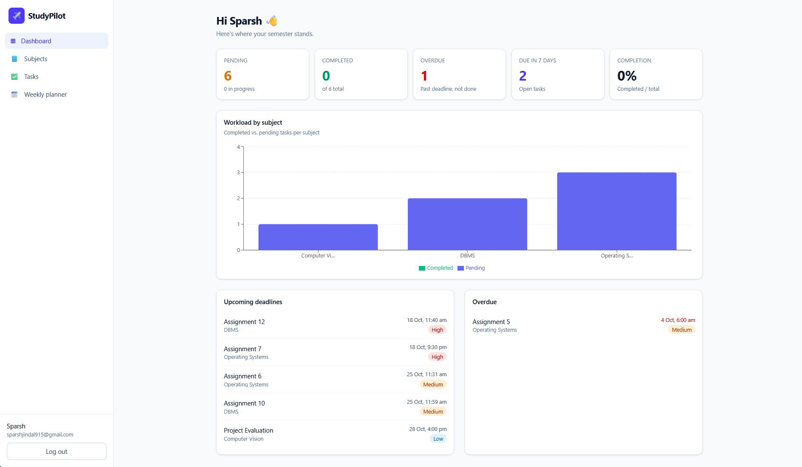
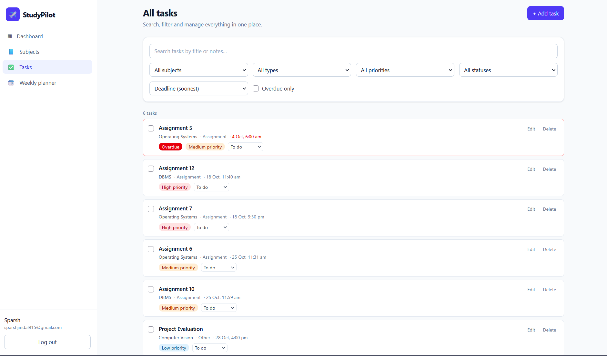
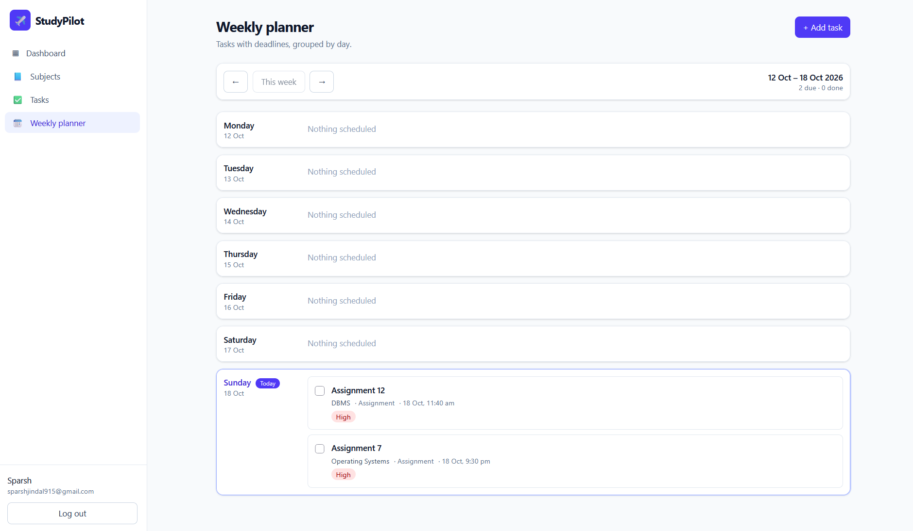

# StudyPilot — Academic Planner for College Students

StudyPilot is a full-stack MERN application that gives a student one place to manage subjects, assignments, exams, labs and study sessions — with deadline tracking, a progress dashboard and a weekly planner.


## Screenshots

### Dashboard


### Task Management


### Weekly Planner


## Features

- **Authentication** — register, log in, log out; passwords hashed with bcrypt; session in a secure HTTP-only cookie
- **Subjects** — add, view, edit, delete; each shows a task count; a subject with tasks cannot be deleted
- **Tasks** — create, edit, complete, delete; types: assignment, exam, study session, lab, other; priority and status
- **Deadlines** — upcoming and overdue tracking (deadline and completion are separate: late ≠ completed)
- **Search, filters, sorting** — by subject, type, priority, status, overdue, and free-text search
- **Dashboard** — pending / completed / overdue / due-in-7-days / completion rate, plus a Recharts workload chart
- **Weekly planner** — tasks grouped Monday–Sunday with week navigation
- **Responsive UI** — sidebar on desktop, drawer on mobile

## Tech stack

| Layer    | Tech                                                         |
| -------- | ------------------------------------------------------------ |
| Frontend | React 18, Vite, React Router, Axios, Tailwind CSS v4, Recharts |
| Backend  | Node.js, Express, Zod (validation), JWT in HTTP-only cookies, bcryptjs, helmet, rate limiting |
| Database | MongoDB + Mongoose                                           |

## Architecture

```
React (Vite)  ──HTTP/JSON──▶  Express API  ──Mongoose──▶  MongoDB
 presentation                 auth, validation,            users, subjects,
                              ownership, business rules    tasks
```

The frontend handles presentation, the backend enforces every rule, the database stores data. Identity always comes from the signed cookie — the client never sends a `userId`.

```
studypilot/
├── client/                 React app
│   └── src/
│       ├── components/     Sidebar, Layout, TaskCard, TaskForm, SubjectCard, StatusBadge, ConfirmDialog, modals…
│       ├── pages/          Login, Register, Dashboard, Subjects, SubjectDetail, Tasks, Planner
│       ├── context/        AuthContext, ToastContext
│       ├── hooks/          useSubjects, useTaskActions
│       ├── services/api.js Axios instance + error helpers
│       └── utils/          date helpers, constants
└── server/
    ├── controllers/        request handlers
    ├── models/             Mongoose schemas
    ├── routes/             Express routers
    ├── middleware/         auth, validation, error handling
    ├── services/metrics.js dashboard calculations (unit-tested)
    ├── scripts/seed.js     demo data
    └── tests/              node:test unit tests
```

## Database structure

**users** — `name`, `email` (unique), `passwordHash`, `createdAt`

**subjects** — `userId`, `name`, `courseCode`, `semester`, `description`, timestamps

**tasks** — `userId`, `subjectId`, `title`, `description`, `type` (`assignment|exam|study_session|lab|other`), `deadline` (nullable), `priority` (`low|medium|high`), `status` (`todo|in_progress|completed`), `estimatedMinutes`, `completedAt`, timestamps

Rules: subject names are unique per user (case-insensitive); a task's subject must belong to the same user; `completedAt` is set when a task becomes completed and cleared when it is reopened.

### Metric definitions

- **Pending** = not completed
- **Overdue** = has a deadline in the past **and** is not completed
- **Due in 7 days** = not completed, deadline between now and now + 7 days
- **Completion rate** = completed ÷ total (rounded %)

## Local setup

**Prerequisites:** Node.js 18+, and MongoDB (local, or a free [MongoDB Atlas](https://www.mongodb.com/atlas) cluster).

```bash
# 1. Install dependencies
npm run install:all          # or: npm install in server/ and client/

# 2. Configure the server
cp server/.env.example server/.env
# edit server/.env: set MONGO_URI and a long random JWT_SECRET

# 3. (optional) Load demo data — login: demo@studypilot.dev / demo12345
npm run seed

# 4. Run both apps (two terminals)
npm run dev:server           # API on http://localhost:5000
npm run dev:client           # App on http://localhost:5173
```

In development Vite proxies `/api` to the Express server, so cookies work without extra CORS setup. Health check: `GET http://localhost:5000/api/health`.

### Environment variables

| Variable | Where | Purpose |
| --- | --- | --- |
| `PORT` | server | API port (default 5000) |
| `MONGO_URI` | server | MongoDB connection string |
| `JWT_SECRET` | server | Secret for signing session tokens (16+ chars) |
| `CLIENT_URL` | server | Allowed CORS origin(s), comma-separated |
| `NODE_ENV` | server | `production` enables secure cookies |
| `COOKIE_SAMESITE` | server | Override cookie SameSite (`lax`/`strict`/`none`) |
| `VITE_API_URL` | client | API base URL (default `/api`) |

## API reference

All routes except register/login require the auth cookie.

| Method | Endpoint | Purpose |
| --- | --- | --- |
| POST | `/api/auth/register` | Create account |
| POST | `/api/auth/login` | Log in |
| POST | `/api/auth/logout` | Log out |
| GET | `/api/auth/me` | Current user |
| GET/POST | `/api/subjects` | List / create subjects |
| GET/PATCH/DELETE | `/api/subjects/:id` | Get / update / delete (409 if it has tasks) |
| GET/POST | `/api/tasks` | List (filters below) / create |
| GET/PATCH/DELETE | `/api/tasks/:id` | Get / update (incl. status) / delete |
| GET | `/api/dashboard/summary` | Counts, upcoming, overdue, per-subject workload |

`GET /api/tasks` query params: `status`, `priority`, `type`, `subjectId`, `search`, `overdue=true`, `from`, `to` (ISO dates, filter on deadline), `sort` (`deadline`, `-deadline`, `priority`, `-priority`, `createdAt`, `-createdAt`, `title`), `page`, `limit`.

Errors are JSON: `{ "message": "...", "details": [{ "field": "...", "message": "..." }] }` with appropriate status codes (400 validation, 401 unauthenticated, 404 not found / not yours, 409 conflict).

## Testing

```bash
npm test            # unit tests for overdue / due-soon / dashboard metrics
```

Manual checklist: register (valid + duplicate email), protected pages redirect to login, create subject → add task → change status → filter by priority, completed tasks never show as overdue, another user's task ID returns 404, deleting a subject with tasks is refused, invalid task data returns clear errors.

## Deployment notes

- **Database:** MongoDB Atlas; put the connection string in `MONGO_URI`.
- **API:** deploy `server/` to Render/Railway/Fly (start command `npm start`). Set `NODE_ENV=production`, `JWT_SECRET`, `MONGO_URI`, and `CLIENT_URL` to your frontend URL.
- **Client:** deploy `client/` to Vercel/Netlify (build `npm run build`, output `dist`). Set `VITE_API_URL=https://<your-api>/api`. Add an SPA fallback rewrite to `index.html`.
- **Cookies:** with the client and API on different domains, production uses `SameSite=None; Secure`, which requires HTTPS on both. The API already sets `trust proxy` for hosted platforms.

## Possible extensions

Drag-and-drop planner, calendar sync, reminders, recurring tasks, a reassign-tasks flow when deleting a subject.
